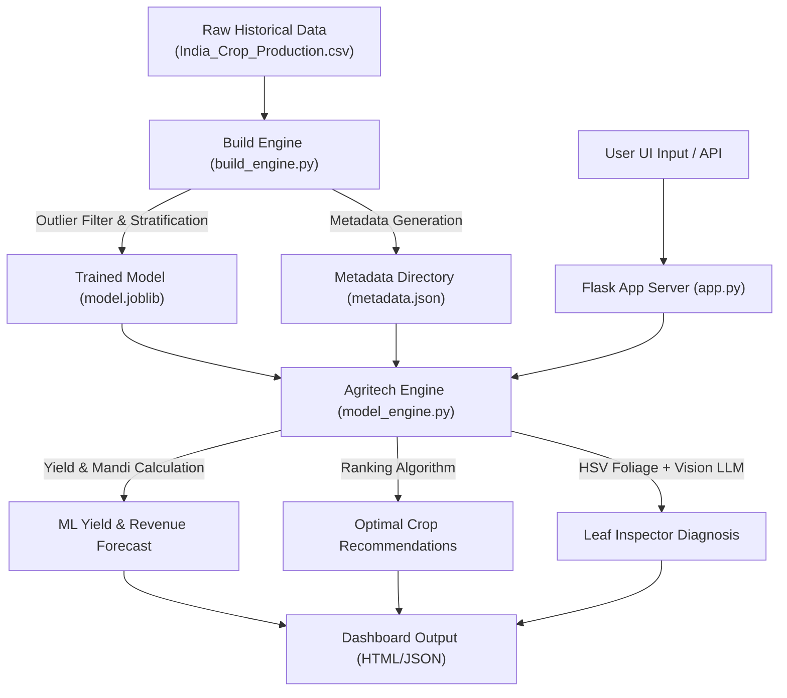

# AgriSmart AI Pro - Precision Indian Crop Yield & Plant Health Platform 🌾

[](https://www.python.org/)
[](https://flask.palletsprojects.com/)
[](https://scikit-learn.org/)
[](https://docs.pytest.org/)
[](LICENSE)

**AgriSmart AI Pro** is a comprehensive, end-to-end precision agritech platform built specifically for Indian agriculture. It combines a Machine Learning Yield & Revenue Forecasting Engine, APMC Mandi Market Valuations, an Optimal Regional Crop Recommender, and a local **Vision AI Leaf Inspector** for plant disease diagnosis.

All land area measurements are standardized in **Acres**, crop yields in **Tons per Acre**, total production in **Metric Tons**, and financial market valuations in **Indian Rupees (INR ₹)**.

---

## 🚀 Key Modules & Features

### 1. 📊 ML Crop Yield & Revenue Forecasting Engine
- **Accurate Predictions**: Standardized output metrics in **Tons/Acre** and total yield in **Metric Tons** based on land area in **Acres**.
- **Financial Revenue Projection**: Calculates expected gross farm revenue in **INR ₹** by multiplying predicted yield with official **APMC Mandi** market price rates.
- **Agronomic Benchmark Safeguards**: Implements category-specific upper-bound caps (foodgrains: ~6 Tons/Acre, sugarcane: ~44 Tons/Acre, heavy vegetables: ~20 Tons/Acre) to eliminate extreme outliers or hyper-inflated synthetic predictions.
- **Smart Two-Way Cascading Selection**: Supports all **33 States** and **646 Districts** of India with bi-directional auto-completion (State-first filtering or District-first auto-detection of State).

### 2. 🍃 AI Leaf Inspector & Disease Diagnosis (Vision LLM)
- **Local Vision AI**: Integrated with local Ollama Vision models (`llava`, `llama3.2-vision`) for 100% private, offline plant health analysis.
- **Computer Vision Foliage Check**: Uses OpenCV HSV color space analysis ($\ge 12\%$ green/yellow/brown vegetation ratio) to verify leaf content before model execution, filtering out non-foliage uploads with clear user guidance.
- **Robust Heuristic Fallback**: Ensures uninterrupted service by providing visual leaf health diagnostics even when the local LLM server is offline.
- **Actionable Agronomic Reports**: Delivers structured Markdown diagnostics detailing disease identity, infection severity, organic remedies, chemical treatments, and preventative field practices.

### 3. 💡 Optimal Regional Crop Recommender
- Ranks top-performing crops for any Indian State, District, and Season (Kharif, Rabi, Summer, Whole Year, etc.).
- Ranks recommendations based on projected yield output (Tons/Acre) and total APMC Mandi market valuation (INR ₹).

### 4. 💰 APMC Mandi Market Rates Directory
- Comprehensive price directory (INR ₹ / Ton) covering **124 Indian crop species** (cereals, pulses, oilseeds, spices, commercial crops, vegetables, and fruits).
- Real-time client-side interactive search and filtering interface.

---

## 📐 Units & Metric Standards

| Parameter | Unit | Symbol | Example |
| :--- | :--- | :--- | :--- |
| **Land Area** | Acres | Acre | `5.0 Acres` |
| **Crop Yield** | Tons per Acre | Tons/Acre | `2.45 Tons/Acre` |
| **Total Production** | Metric Tons | Tons | `12.25 Tons` |
| **Market Rate** | Rupees per Ton | ₹ / Ton | `₹ 23,000 / Ton` |
| **Gross Valuation** | Indian Rupees | INR (₹) | `₹ 281,750.00` |

---

## 🏗️ System Architecture & Workflow



---

## 🛠️ Machine Learning Model & Data Pipeline

- **Dataset**: `India_Crop_Production.csv` (~14.6 MB) containing All-India historical crop production records.
- **Preprocessing Pipeline**:
  - Missing value removal & non-positive area filtering.
  - Global extreme outlier removal ($\le 120 \text{ Tons/Ha}$) and crop-specific 98th percentile capping.
  - Categorical feature encoding via `OneHotEncoder` (`State_Name`, `District_Name`, `Season`, `Crop`).
  - Stratified sampling across crop classes (80,000 balanced samples).
- **Regressor Architecture**: `HistGradientBoostingRegressor` built with Scikit-Learn, yielding fast inference times and high statistical fidelity ($R^2 \approx 92.92\%$).

---

## 💻 Tech Stack

- **Backend Framework**: Python 3.12, Flask 3.0.3, Gunicorn 23.0.0
- **Machine Learning & Data**: Scikit-Learn 1.5.2, Pandas 2.2.3, NumPy, Joblib 1.4.2
- **Computer Vision & Image AI**: OpenCV (`opencv-python`), Pillow (PIL), Requests (Ollama API)
- **Frontend UI**: HTML5, Tailwind CSS 3, FontAwesome 6, Marked.js (Markdown parsing), *Plus Jakarta Sans* & *Space Grotesk* typography
- **Testing**: Pytest 7.4.4 automated test suite (100% test pass rate across 10 test modules)

---

## 📁 Project Structure

```
📦 Crop-Yield-Prediction-main
├── app.py                     # Flask Web Server & RESTful API Endpoints
├── model_engine.py            # Agritech Business Logic, ML Inference & CV Engine
├── build_engine.py            # Dataset Cleaning, Model Training & Metadata Builder
├── model.joblib               # Compressed Scikit-Learn Model Pipeline (~0.2 MB)
├── India_Crop_Production.csv  # Raw All-India Agriculture Production Dataset
├── requirements.txt           # Python Package Dependencies
├── README.md                  # Project Documentation
├── static/
│   ├── metadata.json          # Crop, District, State & Mandi Rates Metadata
│   ├── css/                   # Stylesheets & Custom Styling
│   └── gallery/               # Branding Assets & Images
├── templates/
│   ├── index.html             # Main AgriSmart AI Pro Dashboard (Tabs 1-4)
│   └── predict.html           # Standalone Prediction Form
└── tests/
    └── test_app.py            # Pytest Integration & Unit Test Suite
```

---

## ⚙️ Installation & Quick Start

### 1. Prerequisites
- **Python**: Version 3.9 or higher (Python 3.12 recommended)
- **Git**
- *(Optional)* **Ollama**: Installed locally with `llava` or `llama3.2-vision` pulled for local Vision AI features.

### 2. Environment Setup
```bash
# Clone the repository
git clone https://github.com/BhaveshBhakta/Crop-Yield-Prediction.git
cd Crop-Yield-Prediction

# Create and activate a virtual environment (optional but recommended)
python -m venv venv

# On Windows:
venv\Scripts\activate
# On Linux/macOS:
source venv/bin/activate

# Install dependencies
pip install -r requirements.txt
```

### 3. Rebuilding ML Model & Metadata (Optional)
If you wish to re-process the raw dataset or re-train the machine learning pipeline:
```bash
python build_engine.py
```

### 4. Running Tests
Verify system integrity by running the automated pytest test suite:
```bash
python -m pytest
```

### 5. Launching the Web Application
Start the Flask development server:
```bash
python app.py
```
Open your browser and navigate to: **`http://127.0.0.1:5000/`**

---

## 🔌 API Reference

### 1. Get States
- **Endpoint**: `GET /api/states`
- **Response**:
```json
{
  "states": ["Andhra Pradesh", "Punjab", "Tamil Nadu", ...]
}
```

### 2. Get Districts for State
- **Endpoint**: `GET /api/districts/<state>`
- **Response**:
```json
{
  "state": "Punjab",
  "districts": ["AMRITSAR", "BARNALA", "LUDHIANA", ...]
}
```

### 3. Get Crop List for Location
- **Endpoint**: `GET /api/crops/<state>/<district>`
- **Response**:
```json
{
  "state": "Punjab",
  "district": "LUDHIANA",
  "crops": ["Maize", "Rice", "Wheat", ...]
}
```

### 4. Predict Yield & Revenue
- **Endpoint**: `POST /predict_yield`
- **Payload (JSON or Form)**:
```json
{
  "state": "Punjab",
  "district": "LUDHIANA",
  "season": "Kharif",
  "crop": "Rice",
  "area": 5.0,
  "year": 2024
}
```
- **Response**:
```json
{
  "status": "success",
  "data": {
    "yield_per_acre": 2.45,
    "yield_unit": "Tons / Acre",
    "total_production": 12.25,
    "production_unit": "Tons",
    "mandi_price_per_ton": 23000,
    "estimated_revenue_inr": 281750.0,
    "formatted_revenue": "₹ 281,750.00",
    "benchmark": "High / Optimal Yield",
    "benchmark_color": "green"
  }
}
```

### 5. Recommend Top Crops
- **Endpoint**: `POST /recommend_crop`
- **Payload**:
```json
{
  "state": "Punjab",
  "district": "LUDHIANA",
  "season": "Kharif",
  "area": 2.0
}
```

### 6. Vision Leaf Disease Analysis
- **Endpoint**: `POST /detect_disease`
- **Payload**: `multipart/form-data` with `leaf_image` file.

---

## 🧪 Testing

The repository includes complete test coverage via `pytest` located in `tests/test_app.py`.

To run tests with full verbose output:
```bash
python -m pytest -v
```

---

## 🤝 Contributing

Contributions, feedback, and issue reports are greatly appreciated!
1. Fork the Project
2. Create your Feature Branch (`git checkout -b feature/AmazingFeature`)
3. Commit your Changes (`git commit -m 'Add some AmazingFeature'`)
4. Push to the Branch (`git checkout -b feature/AmazingFeature`)
5. Open a Pull Request

---

## 📜 License

Distributed under the MIT License. See `LICENSE` for more information.
